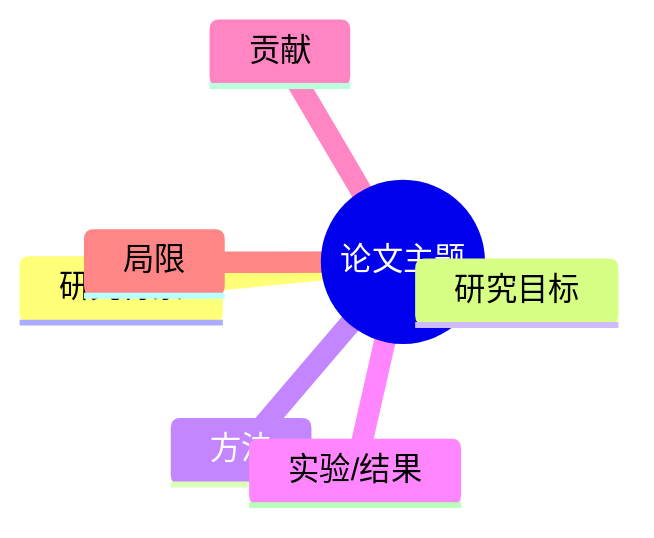

## 知识巩固（预留 asset）

> **预留模板**：当前精读流程默认不调用。仅当用户明确要求“记忆/复习材料”或作为后续独立功能（如 `paper-memory-builder`）的候选模板时使用。
> 巩固材料应基于已读论文或已有精读报告，**不新增论文之外的事实**。

## 论文信息与类型判断

## 核心知识点

- 研究背景与研究问题：
- 方法与关键设计：
- 主要结果与证据：
- 核心贡献：
- 主要局限：
- 知识点之间的联系：

## 思维导图（Mermaid）

## 一页纸总结

> 控制在一页以内，用读者自己的语言回答：研究什么、为什么研究、如何研究、得到什么结果、有什么价值、有哪些不足。

## 理解自测题（5–10 题，含参考答案）

> 侧重对论文思想与逻辑的理解，不设计只依赖记忆数字或公式的机械题。

### 题 1

- **问题**：
- **参考答案**：
